# lightly-train · DINOv3 + EoMT 在 RTX 5090 上的推理与训练优化

> [LightlyTrain](https://github.com/lightly-ai/lightly-train) 0.16.2 的一个 fork，只做一件事：让 **DINOv3 + EoMT 语义分割**在单张 **RTX 5090（sm_120）** 上又快又省。
> 上游的文档、测试和 CI 已移除，只保留运行所需的 `src/`、两个基线脚本和两个优化项目：
> [`infer-opt/`](infer-opt/README.md)（视频推理）与 [`train-opt/`](train-opt/README.md)（训练）。
> 重点是 **BF16 → FP16 累加 → MXFP8 → NVFP4 / MXFP4**：每一档都用自写或移植的 CUDA kernel 落地，并和 baseline 对比。

## 0 结果一览

| | 原版 baseline | 有精度证据的最好档 | 最快档（精度未验证 / 放宽门） |
|---|---|---|---|
| **推理 ViT-L/16**（整段视频 FPS） | 15.1 | **120.4**，r12 FP16 累加，过精度门（r5_v1 BF16：94.7，6.3×） | **207.5**，NVFP4，仅测速（≈ 13.7×） |
| **推理 ViT-B/16** | 16.5 | **241.7**，r12（r5_v1：214.1，13.0×）；已被视频解码卡住 | **243.9**，NVFP4；GPU 上限 553 FPS |
| **训练 ViT-L/16**（img/s，batch 7） | 16.3（FP32/TF32） | **68.9**，FINAL（MXFP8），过严格门，4.22× | **81.9**，P3（NVFP4），过放宽门，**5.04×** |
| **训练 ViT-B/16**（img/s，batch 14） | 37.8 | **161.9**，FINAL，4.29× | **191.4**，P3 速度档，5.06×；默认推荐 P3_H2：177.4（4.7×） |

- 推理的"≈ 倍率"是用 R9 的 6.3× / 13.0× 乘以同场次倍率估出来的（跨场次，只作参考）。
- **MXFP8 / NVFP4 / MXFP4 的整模型推理只测了速度**：精度门已按项目决定（2026-10-05）关闭，因为 checkpoint 是 bf16 训练的，详见 [§6](#6-如实说明与未完成项)。
- 全部数字来自 `infer-opt/` 与 `train-opt/` 各轮的 `NOTES.md` / `results.json`，本 README 没有新跑任何实验。

## 1 硬件与环境

| 项 | 值 |
|---|---|
| GPU | RTX 5090（sm_120，170 SM，575 W），实测 DRAM 约 1.53 TB/s |
| 软件 | torch 2.12.1+cu130、CUDA 13.0、triton 3.7.1、Python 3.12；QuACK 0.6.5（CuTe DSL GEMM）、TileLang |
| 数据 | 推理：一段真实视频（1900×1440，126 帧）；训练：COCO polygon 转语义分割，两类（背景 + head），3672 / 477 张 |
| 权重 | `vitl-best.pth` / `vitb-best.pth`（DINOv3 ViT-L/16、ViT-B/16 + EoMT head） |
| 计时 | 一律持 GPU 锁、CUDA graph 回放、候选交替、3 轮取中位数；容器里不能用 ncu，所以靠 nsys + 解析 roofline |

```text
lightly-train/
├── README.md                      本文件
├── assets/                        本文 16 张手绘图（figures/）和生成脚本（make_figures.py）
├── src/lightly_train/             上游 LightlyTrain 0.16.2，未改动
├── scripts/
│   ├── train_dinov3_eomt_head.py          基线：训练
│   └── infer_dinov3_eomt_head_video.py    基线：视频推理
├── infer-opt/                     推理优化，round0 … round15
├── train-opt/                     训练优化，round0 … round26
└── pyproject.toml  LICENSE  NOTICE  licences/  CITATION.cff
```

## 2 数字格式速览

| 格式 | 位 / 值 | 元素 | scale | 本机指令峰值 | 备注 |
|---|---:|---|---|---:|---|
| FP32 | 32 | fp32 | – | 118 TFLOPS（FMA） | TF32 的 mma 约 123 |
| BF16 | 16 | bf16 | – | 247 | fp32 累加，GeForce 上被限速 |
| FP16 累加 | 16 | fp16 | – | 493 | fp16 累加不限速；每个 k-tile 提升到 fp32 |
| **MXFP8** | 8.25 | E4M3 | UE8M0，每 1×32 | 981 | block-scaled `mma.sync kind::mxf8f6f4` |
| **NVFP4** | 4.5 | e2m1 | E4M3 每 1×16 + fp32 每张量 | 1964 | `kind::mxf4nvf4`；sm_120 上 4 位操作数必须 K-major |
| **MXFP4** | 4.25 | e2m1 | UE8M0，每 1×32 | 1965 | 与 NVFP4 同速率，误差更大 |

峰值来自 `infer-opt` round10 §1 的指令速率微基准。整个模型里 attention、LayerNorm、RoPE、softmax 统计量、残差流、优化器仍然是 BF16 / FP16 / FP32，所以整模型倍率远低于峰值倍率（[图 5](#infer-05)）。

## 3 与 baseline 的对比

### 3.1 推理

整模型，CUDA graph 回放，同场次交替、3 轮取中位数（`infer-opt/round12_lowp_stack/speed12.py`）。baseline 是已经优化过的 BF16 栈 `r5_v1`（R9），原脚本在下一小节。

**ViT-L/16**

| 精度 | 变体 | 可信度 | 模型段 ms | × | GPU 上限 FPS | 视频 FPS | × | ≈ 对原脚本 | mask-logit cos |
|---|---|---|---:|---:|---:|---:|---:|---:|---:|
| BF16（baseline） | `r5_v1` | 过门 | 9.77 | 1.00 | 100.7 | 94.6 | 1.00 | 6.3× | 1 |
| FP16 累加 | `r12+head16` | **过门 M/H/G** | 7.08 | 1.38 | 128.9 | 120.4 | 1.27 | ≈ 8.0× | 0.999996 |
| MXFP8 | `r13_mx8best` † | 只测速 | 4.90 | 1.98 | 200.7 | 183.4 | 1.88 | ≈ 11.8× | 0.99989 |
| NVFP4 | `r14_nv4a` | 只测速 | **4.02** | **2.43** | 243.9 | 207.5 | 2.19 | ≈ 13.7× | 0.9990 |
| MXFP4 | `r14_mx4a` | 只测速 | 4.04 | 2.42 | 242.9 | 207.6 | 2.19 | ≈ 13.7× | 0.9960 |

**ViT-B/16**（视频 FPS 被 host / cv2 解码卡在约 240–290，所以看 GPU 上限列）

| 精度 | 变体 | 可信度 | 模型段 ms | × | GPU 上限 FPS | × | 视频 FPS | mask-logit cos |
|---|---|---|---:|---:|---:|---:|---:|---:|
| BF16（baseline） | `r5_v1` | 过门 | 3.62 | 1.00 | 264.5 | 1.00 | 215.4 | 1 |
| FP16 累加 | `r12` | **过门 M/H/G** | 2.70 | 1.34 | 352.6 | 1.33 | 241.7 | 0.999992 |
| MXFP8 | `r13_mx8best` † | 只测速 | 1.94 | 1.90 | 497.6 | 1.91 | 272.4 | 0.9995 |
| NVFP4 | `r14_nv4a` | 只测速 | **1.74** | **2.08** | 553.5 | 2.09 | 243.9 | 0.9972 |
| MXFP4 | `r14_mx4a` | 只测速 | 1.75 | 2.07 | 548.4 | 2.07 | 239.8 | 0.9883 |

† MXFP8 一行来自 round13 的另一场（该场 baseline：ViT-L 9.711 ms / 97.3 FPS，ViT-B 3.680 ms / 260.2 FPS），其余来自 round14 最终场，两场 baseline 相差不到 2%。同一场次的总表脚本 `infer-opt/round15_final_table/run_final.sh` 已写好但没有产出结果。

**原脚本（PyTorch eager，每次迭代同步，round0）里的 FP32**

| 模型 | 精度 | 模型段 ms | e2e ms | e2e FPS |
|---|---|---:|---:|---:|
| ViT-L/16 | FP32 | 40.84 | 81.09 | 12.3 |
| ViT-L/16 | BF16 autocast（原脚本默认） | 17.05 | 60.65 | 16.5 |
| ViT-B/16 | FP32 | 15.26 | 57.91 | 17.3 |
| ViT-B/16 | BF16 autocast（原脚本默认） | 9.62 | 51.71 | 19.3 |

优化栈里没有"FP32 优化版"：FP32 只出现在原脚本档，以及所有栈内部的残差流、LN 统计量、RoPE 和 softmax 统计量。上表是逐次同步的单帧口径；§0 里的原脚本 15.1 / 16.5 FPS 是整段视频口径（解码 + `predict_head` 的串行循环），两者不能混着除。

### 3.2 训练

加权 img/s（early / mid / late 三个阶段按 0.2 / 0.6 / 0.2 加权），batch 固定（ViT-L 7，ViT-B 14），整步在 CUDA graph 下。

| 精度档 | 栈 | ViT-L | ViT-B | 对 R0 | 梯度余弦 vs R0（中位 / 最小，24 批） |
|---|---|---:|---:|---|---|
| FP32 / TF32（baseline） | R0 | 16.3 | 37.8 | 1.00× | – |
| FP32 清理 | P0 | 18.0 | 44.4 | 1.10× / 1.18× | – |
| BF16 | FINAL_noMX / P1 | 54.4 | 139.6 | 3.33× / 3.70× | 0.9997 / 0.9928 · 0.9993 / 0.9954 |
| MXFP8 | FINAL | 68.9 | 161.9 | 4.22× / 4.29× | 0.9960 / 0.9854 · 0.9947 / 0.9804 |
| **NVFP4** | **P3** | **81.9** | **191.4** | **5.04× / 5.06×** | 0.9914 / 0.9823 · 0.9895 / 0.9749 |
| MXFP4 | 未做整步实测 | – | – | – | 0.9921 / 0.9796 · 0.9874 / 0.9758（仿真，8 批） |

- 梯度余弦那一列：左 ViT-L，右 ViT-B；BF16 一行取 P1（TB1，BF16 autocast）的数据，数值族与 FINAL_noMX 相同。P3 对 R0 的倍率取自 round23 同机重测（R0 = 16.25 / 37.82）。
- MXFP4：GEMM 只比 NVFP4 快 3–7%，估计整步再省约 0.5 ms；R20b 里作为对照臂（torch 量化器 + 真实 FP4 GEMM）的数字只能算仿真。

<a id="infer-05"></a>
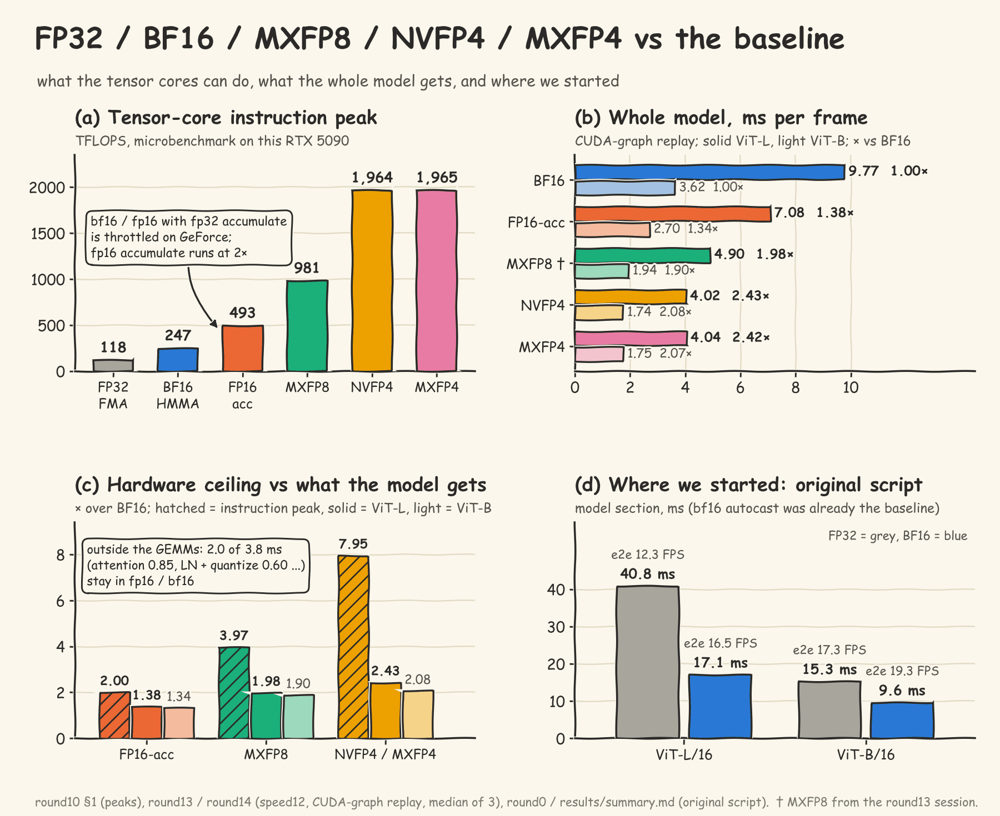

<a id="train-04"></a>
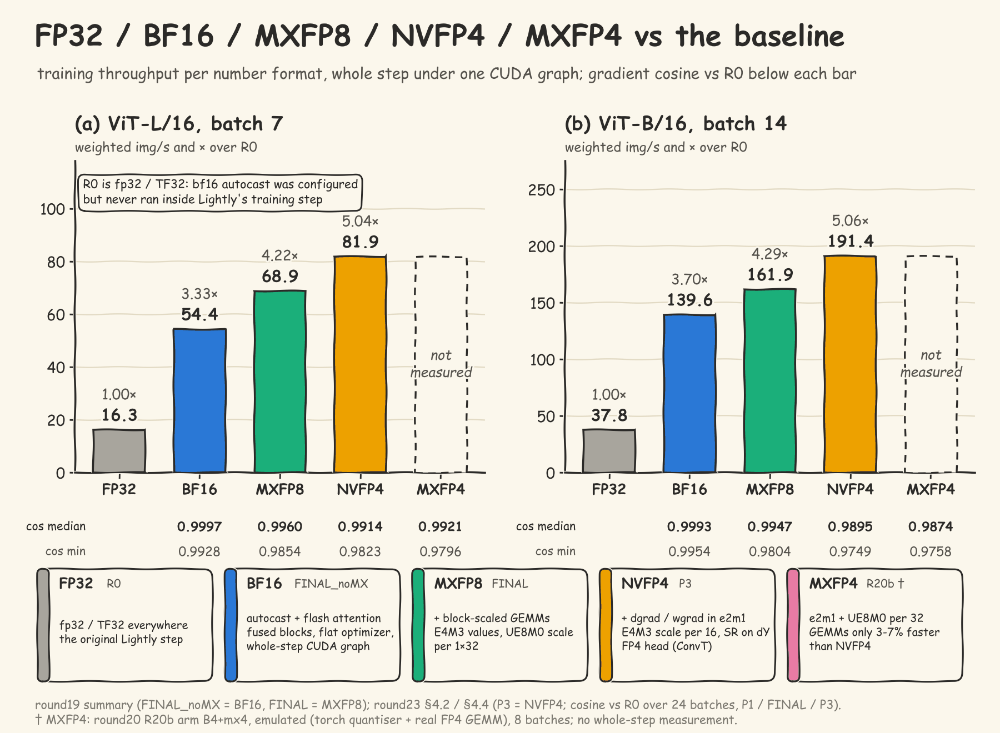

## 4 infer-opt：视频推理，15 FPS → 95 FPS（有精度门）→ 207 FPS（仅测速）

基线是 `scripts/infer_dinov3_eomt_head_video.py`（eager + bf16 autocast）。优化分两个阶段：

1. **系统与融合（R0–R9）**：把时间花在 CPU 上的前后处理搬到 GPU，整帧塞进一张 CUDA Graph，融合 block 并调 sm_120 的 GEMM。结果 6.3× / 13.0×，全程过精度门。
2. **低精度（R10–R14）**：在 R9 的 `r5_v1` 上换 GEMM 的数字格式和 attention 的累加方式，并自写 block-scaled GEMM。

| 轮次 | 内容 | 关键结果（ViT-L） |
|---|---|---|
| R0 baseline | eager 基线、实测峰值、nsys | 每帧 60.7 ms = prep 5.8 + model 17.1 + **post 35.4（CPU numpy argmax，GPU 忙碌率 7%）** |
| R1 torch 清理 | bf16 权重常驻、预计算 RoPE、折叠 LayerScale | model 17.1 → 12.9；flash SDPA 不过门，改用 cuDNN |
| R2 CUDA Graph | 与 `torch.compile` 对比 | graph 12.6；compile max-autotune 10.3 |
| R3 融合 | TileLang GEMM epilogue 融合（RoPE / GELU / 残差）+ add-LN | 每层 40 → 7 个 kernel；**残差流必须 fp32** |
| R4 attention | TileLang FlashAttention（sm_120），可选融合 RoPE | 融合 RoPE 比 flash + RoPE 算子快 35–40% |
| R5 GEMM | sm_120 tile 调优、split-K、LN prologue | 整模型快 4.3% / 6.7%（L / B） |
| R6 低精度初筛 | 逐行 FP8、MXFP8、NVFP4 | 旧精度门下覆盖空间很小 |
| R7 前后处理 | GPU 上的 prep / post / 融合 head | e2e 60.7 → 17.4 ms |
| R8 流水线 | 解码写 pinned ring，H2D / compute / D2H 三 stream | 15.5 → 57.3 FPS |
| R9 集成 | 整帧单图 CUDA Graph + 可插拔 `model_fn` | **94.7 / 214.1 FPS（6.3× / 13.0×）** |
| R10 低精度探针 | 张量核峰值、GEMM 速度矩阵、精度仿真 | fp16 累加 1.99×，MXFP8 / INT8 3.97×，FP4 7.95× 的指令速率 |
| R11 BF16 等价小项 | patch-embed GEMM、dw_ln、post_a、尾部融合；attention 候选矩阵 | ViT-L +3.4%，ViT-B +6.7% |
| R12 FP16 累加栈 | fp16 GEMM + fp16 累加 attention，生产者到消费者直接传 fp16 | ViT-L 96.3 → 124.3 FPS，ViT-B 227 → 273 FPS；门 M/H/G 全过 |
| R13 整模型 MXFP8 | 自写 `kind::mxf8f6f4.block_scale` GEMM，LN + 量化融合，fc1 epilogue 直接量化 | 模型段 1.98× / 1.90× |
| R14 整模型 NVFP4 / MXFP4 | QuACK `kind::mxf4nvf4.block_scale` GEMM + 自定义 epilogue + fp4q2 量化器 | 模型段 2.43× / 2.08× |
| R15 总表 | 同场次的 5 档总表脚本 | 只有脚本，没有结果 |

### 4.1 一帧的时间去了哪里

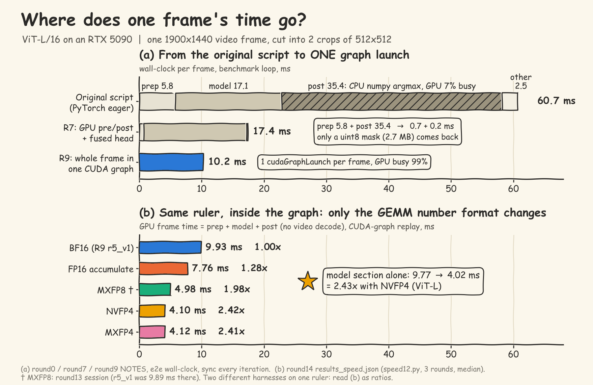

- 原脚本每帧 60.7 ms，其中 **post 35.4 ms 是 CPU 上的 numpy argmax**（把 2×1440×1900 的 fp32 logits，21.9 MB，从 pageable 内存拷回 host 再逐像素处理，GPU 忙碌率只有 7%），prep 5.8 ms 也在 CPU（cvtColor → PIL → pageable H2D）。
- R7 用 3 个 kernel 替换它们，只回传 2.7 MB 的 uint8 mask：e2e 60.7 → 17.4 ms。R9 再把 prep → model → post 放进同一张图，服务延迟 10.24 ms。
- 之后只剩模型段：下半图是同一把尺子下 GPU 帧时间 BF16 9.93 ms → NVFP4 4.10 ms。两个面板是不同的计时口径（逐次同步的循环 vs CUDA graph 回放，不含解码），看比例，不要把 60.7 和 4.1 直接相除。

### 4.2 FPS 阶梯

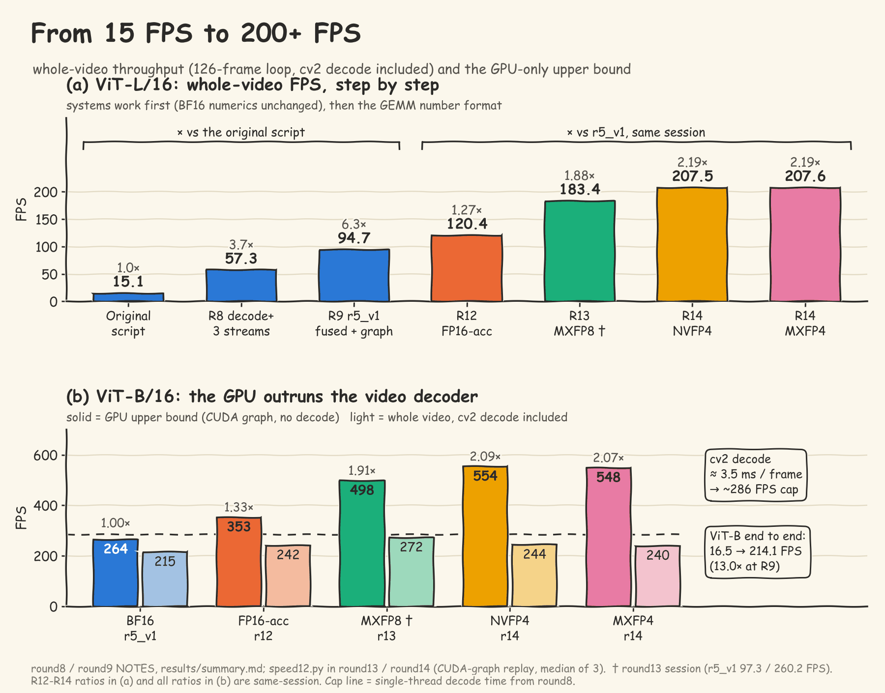

- 前三根（原脚本 → R8 → R9）数值格式不变，全是系统工作：15.1 → 57.3 → 94.7 FPS。后四根才是 GEMM 的数字格式。
- ViT-B 在 R12 之后就被解码卡住：单线程 cv2 解码约 3.5 ms / 帧，对应约 286 FPS 的上限；GPU 上限已经到 553 FPS。再往下压 GPU 时间，视频 FPS 看不出来，需要换解码（NVDEC 要额外装包，尚未决定）。

### 4.3 网络结构，以及一个 transformer block 的四种数字格式

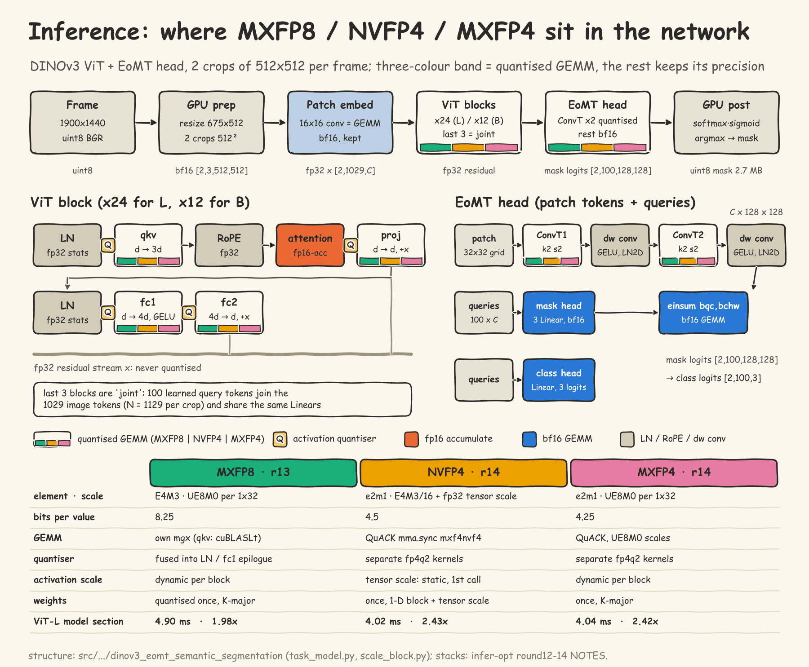

- 一帧的路径：GPU prep → patch embed → ViT blocks（ViT-L 24 个，ViT-B 12 个）→ EoMT head → GPU post。被量化的只有 6 类 GEMM：每个 block 里的 qkv / proj / fc1 / fc2，和 head 里的 ConvT1 / ConvT2。
- 不量化的：patch-embed、attention（fp16 累加）、mask head 的 3 个 Linear、einsum、class head、LN / RoPE / depthwise conv，以及始终是 fp32 的残差流。
- 最后 3 个 block 是 joint block：100 个 query token 与 1029 个图像 token（cls + 4 个 register + 32×32 个 patch）一起走同样的 Linear，N = 1129。head 里两个 ScaleBlock（ConvT k2 s2 → GELU → depthwise 3×3 → LN2D）把 32×32 的 patch 网格放大到 128×128，再与 mask head 输出的 query 向量做 einsum 得到 mask logits。
- 三个栈占的是同样的位置，区别在格式（图底部的表）：MXFP8 把量化融合进 LN 和 fc1 的 epilogue；NVFP4 / MXFP4 用独立的量化 kernel，NVFP4 的每张量 scale 在第一次调用时静态标定。

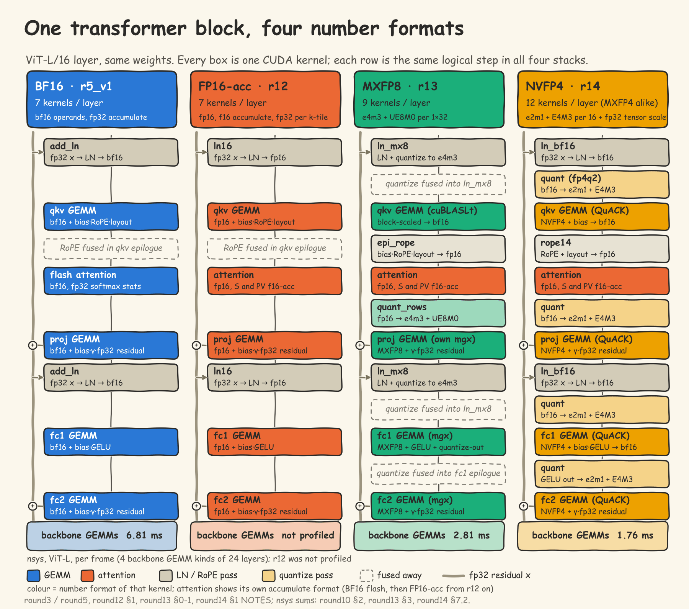

- BF16 / FP16：每层 7 个 kernel（add-LN、qkv+RoPE、attention、proj+残差、add-LN、fc1+GELU、fc2+残差），所有 epilogue 都融合在 GEMM 里。
- MXFP8：每层 9 个 kernel。LN 与量化合成一个 kernel；**fc1 的 epilogue 直接把 GELU 输出量化成 fc2 的 e4m3 操作数**；qkv 走 cuBLASLt，RoPE 另走一遍。
- NVFP4 / MXFP4：每层 12 个 kernel。现成的 QuACK GEMM 只带 bias / GELU / 残差 epilogue，量化和 RoPE 都是独立的小 kernel，这正是下面 [§4.6](#46-kernel-账) 里 FP4 帧里剩下的主要开销。
- 每一列左边那根灰线是 fp32 残差流（"+" 是 proj / fc2 写回的位置）：任何栈里它都不降精度。

### 4.4 流水线与整帧 CUDA Graph

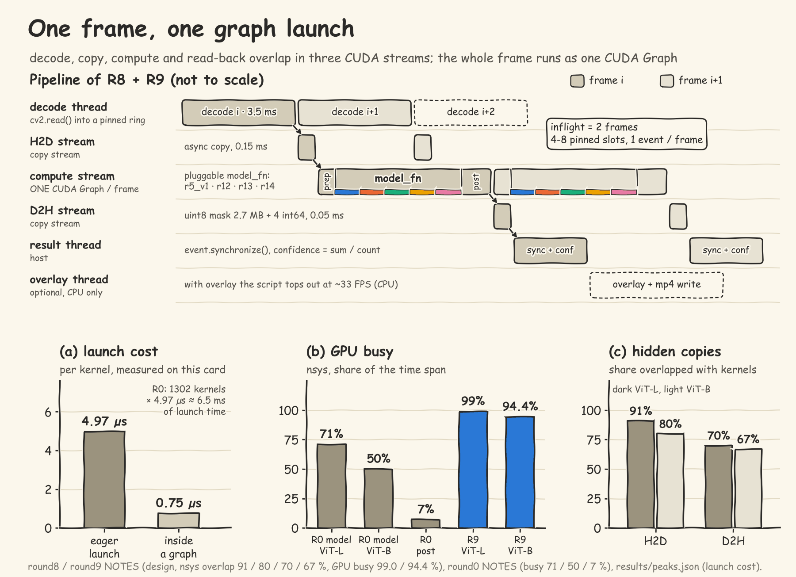

- 解码线程用 `cv2.VideoCapture.read()` 直接写进 pinned ring，H2D、compute、D2H 各占一个 stream，用 event 串起来；`inflight = 2` 就够。
- 每帧 GPU 上只有 **1 次 graph launch**：eager 下每个 kernel 约 4.97 µs，graph 里约 0.75 µs；原脚本 1302 个 kernel 光 launch 就要 6.5 ms。GPU 忙碌率 71% / 50% → 99.0% / 94.4%。
- H2D 有 91%（ViT-L）/ 80%（ViT-B）被 compute 盖住，D2H 70% / 67%。

### 4.5 数字格式 × 速度

图见 [§3 的图 5](#infer-05)。要点：

- 指令峰值是 BF16 的 2.0× / 3.97× / 7.95×（FP16 累加 / MXFP8 / FP4），整模型却只拿到 1.38× / 1.98× / 2.43×（ViT-L）。
- 原因是 Amdahl：NVFP4 帧里 3.82 ms 中只有 1.83 ms 是 GEMM，其余是 fp16 attention、LN + 量化、RoPE 等。
- 原脚本里 FP32 比 BF16 autocast 慢（0.75×），所以 BF16 已经是合理的起点。

### 4.6 kernel 账

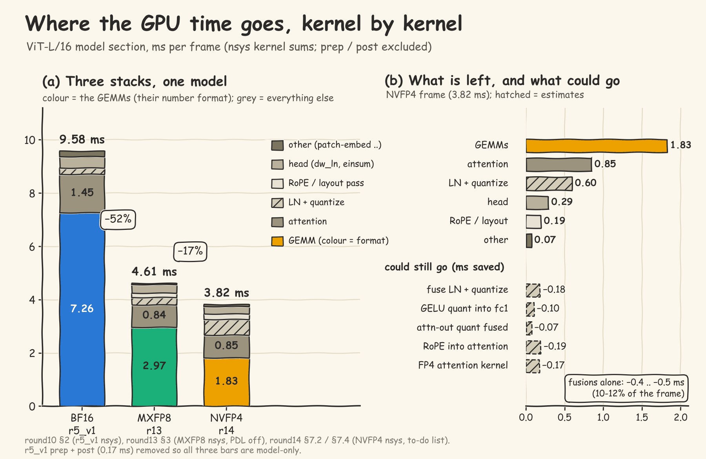

- 同一个 ViT-L，模型段 kernel 时间 9.58 → 4.61 → 3.82 ms。GEMM 从 7.26 → 2.97 → 1.83 ms；attention 从 BF16 flash 的 1.45 ms 换成 fp16 累加后降到 0.84 ms，之后不再变（R13 / R14 都原样用 R12 的 kernel）；LN + 量化反而从 0.23 涨到 0.60 ms。
- 还没做的融合（round14 §7.4，**估计，未实现**）：LN + 量化合并约 −0.18 ms，GELU 量化并进 fc1 epilogue 约 −0.10，attention 输出量化约 −0.07，RoPE 进 attention 前处理最多 −0.19，合计 −0.4 … −0.5 ms（10–12%）。FP4 attention（Sage3）还能再省约 0.17 ms，但需要先把量化融合掉。

### 4.7 速度换来了什么精度代价

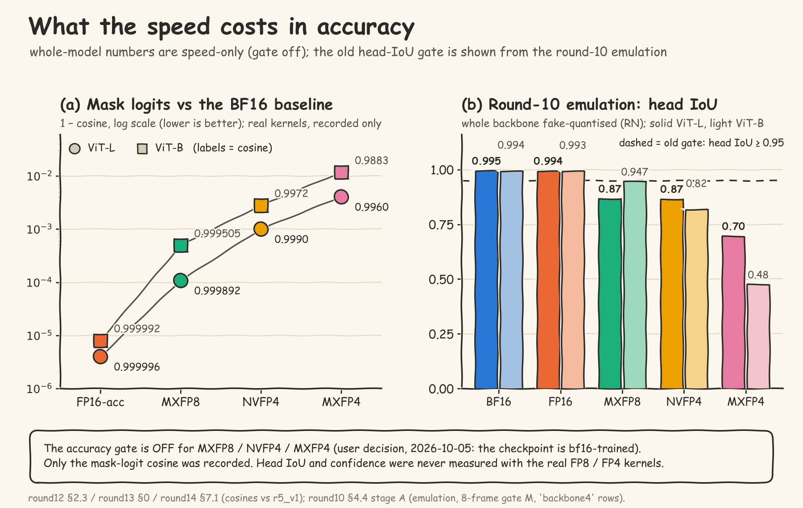

| 层级 | 变体 | 证据 |
|---|---|---|
| ✅ 过精度门 | `r5_v1`（BF16）、`r11`、`r12`（FP16 累加） | 8 帧门 M + 126 帧门 H + graph = eager（G）。ViT-L `r12`：池化 head IoU 0.9964，置信度误差最大 2.52%；ViT-B `r12`：0.9954 / 0.34% |
| ⚠ 只测速 | `r13` MXFP8、`r14` NVFP4 / MXFP4 | 门已关闭（项目 2026-10-05 决定：checkpoint 是 bf16 训练的，不指望低精度过门）；只记录 mask-logit 对 baseline 的余弦 |
| ❌ 仿真里过不了旧门 | 整个骨干四类 GEMM 量化成 MXFP8 / NVFP4 / MXFP4 | round10 假量化（RN、无技巧）：head IoU ViT-L 0.867 / 0.866 / 0.696，ViT-B 0.947 / 0.819 / 0.477，门线 0.95 |

没有在自己的数据上跑过 IoU / 置信度之前，不要把 MXFP8 / FP4 整模型当作可部署。ViT-L 对 ulp 级扰动很敏感（第 7 个评测帧只有 1139 个 head 像素），同一精度档位换一种舍入，置信度误差就可能在 0.5% 到 5.7% 之间跳。

### 4.8 怎么跑

```bash
# 有精度证据的入口：r5_v1（BF16）整帧 CUDA Graph + 流水线
cd infer-opt
python round9_integration/video_infer.py --model /path/to/vitl-best.pth \
    --video-dir /path/to/1.mp4 --out-dir /path/to/infer_out

# 低精度整模型测速（不含精度门）：FP16 / MXFP8 / NVFP4 / MXFP4
cd infer-opt/round12_lowp_stack
python speed12.py --model vitl16 \
    --variants r5_v1,r12+head16,r13_mx8best,r14_nv4a,r14_mx4a \
    --plugin ../round13_mxfp8_full:plug13 --plugin ../round14_fp4_full:plug14 \
    --tag demo --out /tmp/speed_demo.json
```

- 低精度栈目前**只有测速和门入口**（`speed12.py`、`bench12.py`），还没有接进 `video_infer.py`。
- 默认路径（`/root/autodl-tmp/{vitl,vitb}-best.pth`、`1.mp4`、GPU 锁文件）写在 `infer-opt/common/` 里，换机器要改。所有计时脚本持双锁（`common/lock2.py`），要求独占 GPU。
- 只支持 2 个类别加 void、单路视频、宽图两个 crop；竖图自动回退 `lightly`。

## 5 train-opt：训练加速，16.3 → 81.9 img/s（5.04×）

| 阶段 | 做了什么 | 结果 |
|---|---|---|
| 一（R0–R10） | 在 FP32 语义下清理：去同步、padded loss / matcher、attention、flat 优化器 | ViT-L 16.4 → 18.3 img/s，到顶 |
| 二（R11–R19） | BF16 autocast、QuACK 融合块、融合 head、MXFP8 GEMM、flat 优化器、**整步 CUDA graph** | FINAL：**4.22× / 4.29×** |
| 三（R20–R26） | NVFP4：自写融合 FP4 量化器，head 与骨干的 dgrad / wgrad 走 NVFP4 | P3：**5.04× / 5.06×** |

第一阶段到顶的根因：脚本里配置了 `bf16-mixed`，但 Lightly 的 `training_step` 根本没有跑在 autocast 里，实际是 FP32 / TF32。

### 5.1 一步的时间

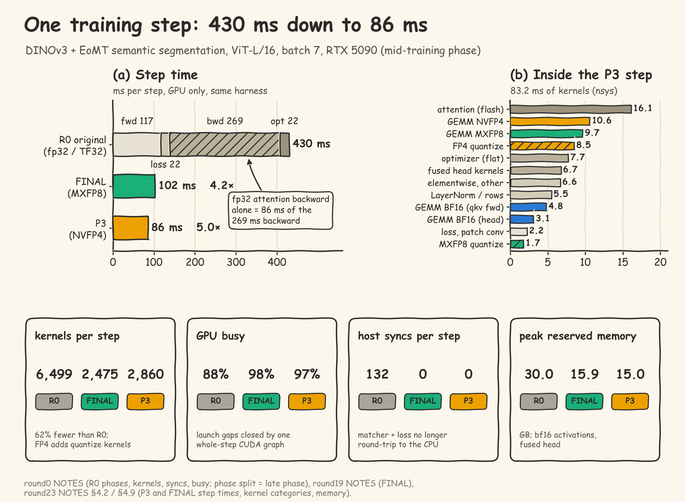

- 原版一步 430 ms：反向 269 ms（其中 fp32 attention 反向一个 kernel 就 86 ms），loss + matcher 还有 112 次 host 同步。
- FINAL 把 kernel 数从 6,499 砍到 2,475，GPU 忙碌率 88% → 98%，host 同步 132 → 0。P3 的 kernel 数反而多了 385 个（FP4 量化 kernel），但步时从 102 降到 86 ms。
- P3 一步 83.2 ms 的 kernel 时间里，attention 16.1 ms 是最大的单项，FP4 量化 8.5 ms 是最大的"新"开销。

### 5.2 吞吐阶梯

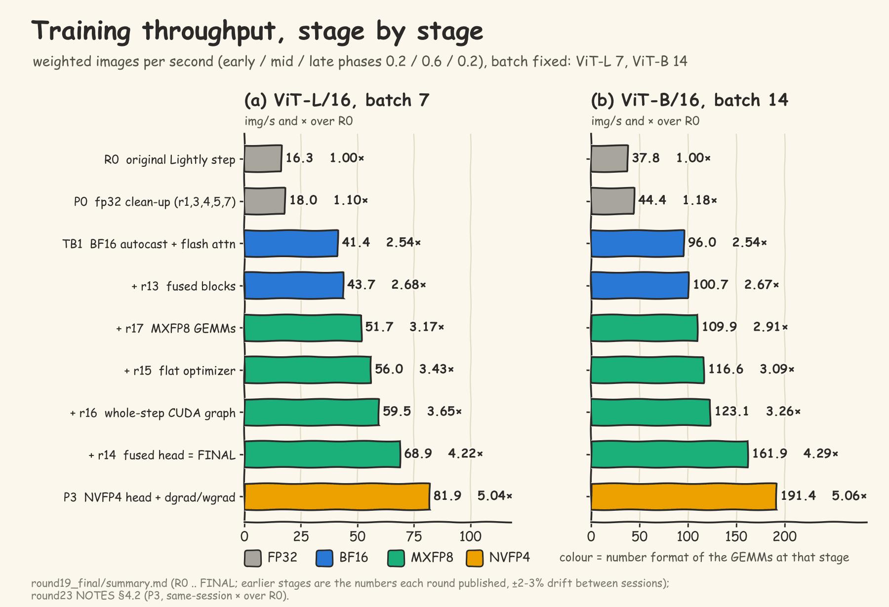

最大的两步是 **BF16 autocast + flash / cuDNN attention（1.10× → 2.54×）** 和 **P3 的 NVFP4（4.22× → 5.04×）**；MXFP8 GEMM、flat 优化器、整步 graph、融合 head 各贡献 5–20%。早期各阶段的数字是各轮自己发布的，不同时段有 ±2–3% 漂移。

### 5.3 网络结构，以及哪个 GEMM 用什么格式

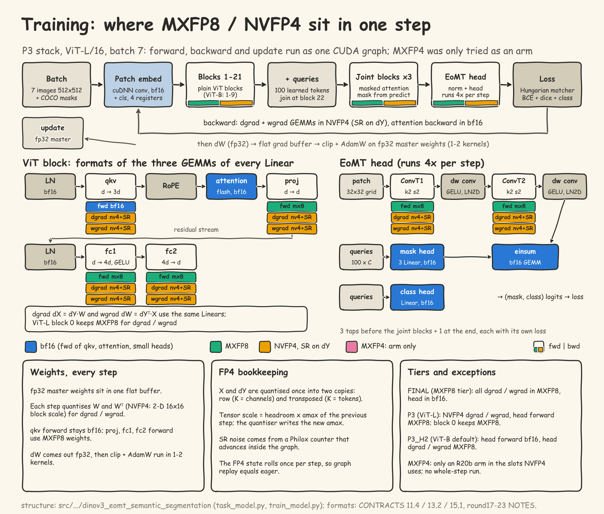

- 一步 = 前向 → loss → 反向 → 更新，整步在一张 CUDA graph 里。EoMT head **每步跑 4 次**（3 个 joint block 之前各一次，加上最后一次），loss（Hungarian matcher + mask BCE + dice + class）对 4 层求和。
- 低精度只发生在 Linear 和 ConvT 的 GEMM 上：前向用 MXFP8（qkv 前向仍是 BF16），dgrad / wgrad 在 P3 里用 NVFP4 + SR。attention（flash，BF16）、LN、RoPE、mask / class head、loss 和优化器（flat fp32 master + AdamW）都不降精度。
- MXFP4 在训练里只是 R20b 的对照臂，占 NVFP4 的位置，没有整步实测。

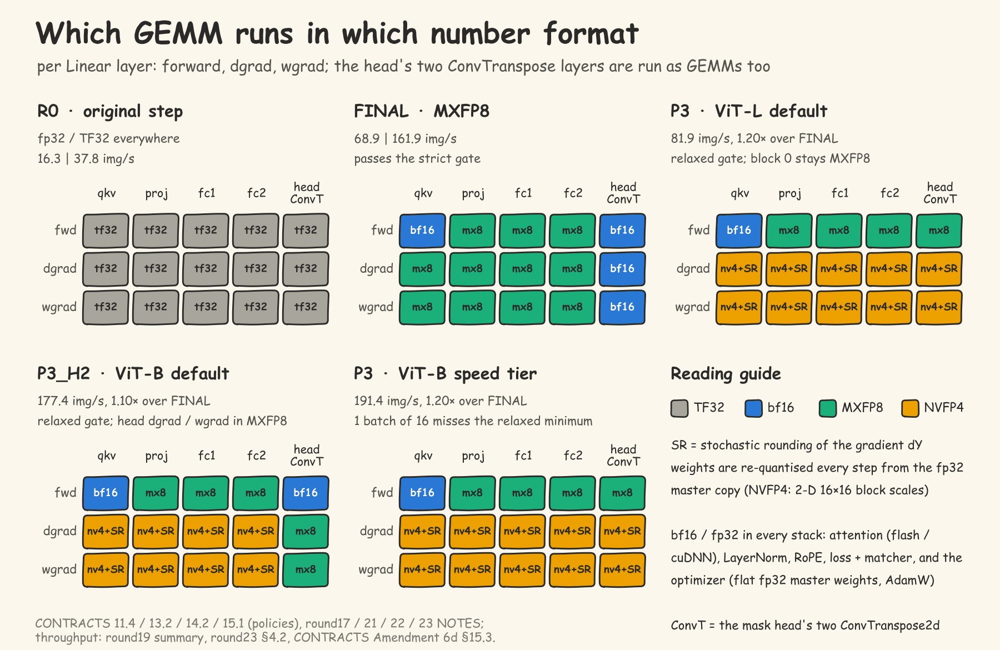

- FINAL：qkv 前向 BF16，其余 Linear 的三个 GEMM 全是 MXFP8，head 是 BF16。
- P3：dgrad / wgrad 全部换成 NVFP4（梯度 dY 用随机舍入 SR），前向保持不变，head 前向用 MXFP8。ViT-L 的 block 0 留在 MXFP8（`nofirst`）。
- ViT-B 的默认推荐是 **P3_H2**：骨干同 P3，head 的 dgrad / wgrad 改成 MXFP8、前向 BF16；P3 本身是速度档。

### 5.4 GEMM 层面：速度与误差

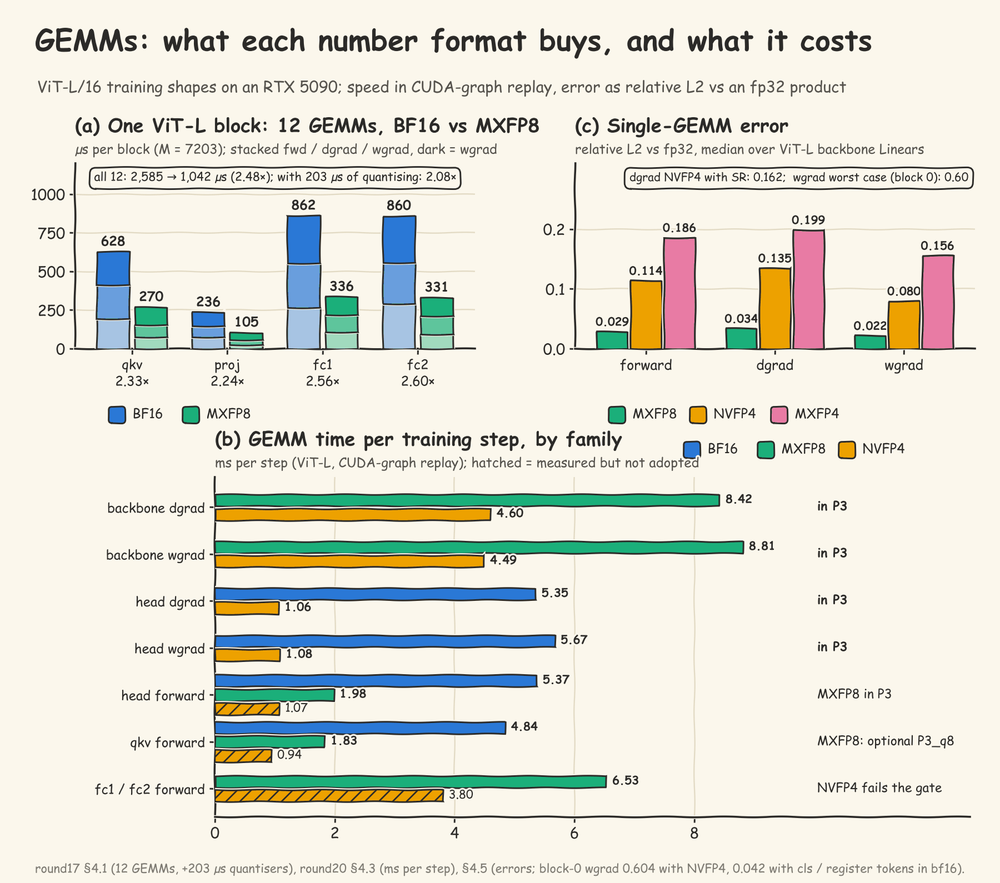

- 一个 ViT-L block 的 12 个 GEMM：BF16 2585 µs → MXFP8 1042 µs（2.48×），加上 203 µs 的量化后净 2.08×。
- 每步 GEMM 时间：head dgrad / wgrad 从 BF16 的 5.4–5.7 ms 降到 NVFP4 的 1.1 ms；骨干 dgrad / wgrad 从 MXFP8 的 8.4–8.8 ms 降到 4.5–4.6 ms。
- 误差：MXFP8 约 0.03，NVFP4 约 0.11，MXFP4 约 0.19（单 GEMM，相对 L2）。**fc1 / fc2 前向用 NVFP4 过不了放宽门**，永久放弃；qkv 前向用 MXFP8 能再快 3.7%（ViT-L），但没有验证齐，只作可选档 `P3_q8`。

### 5.5 FP4 路径怎么工作

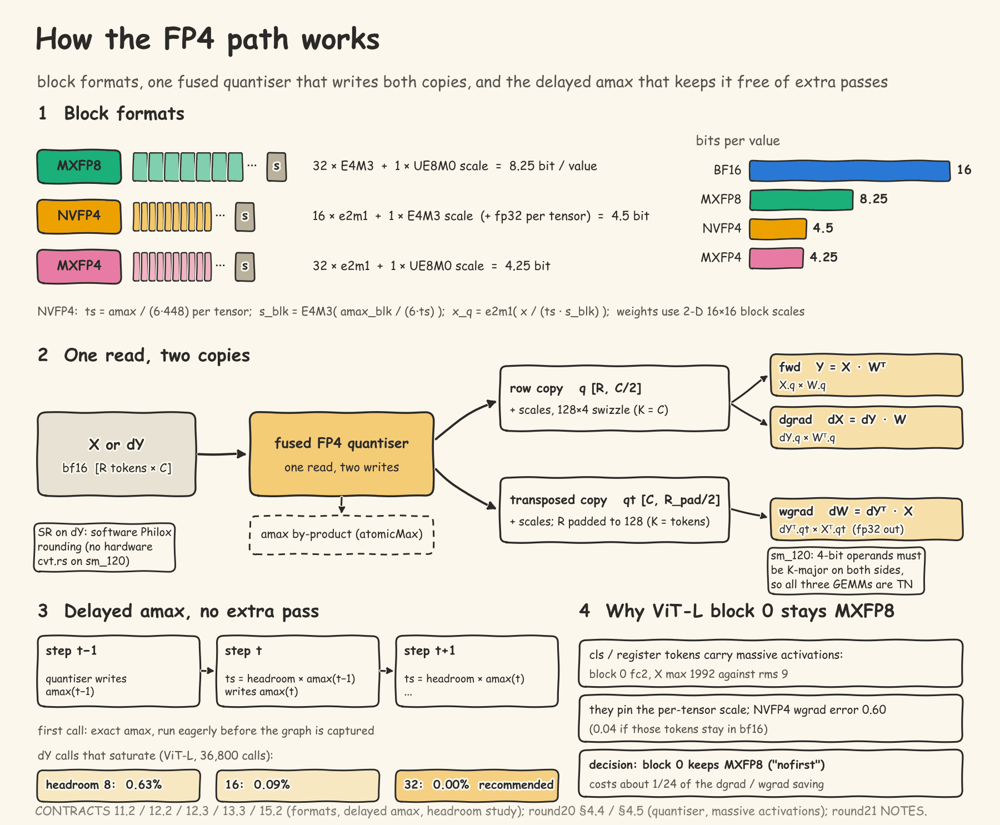

- sm_120 上 4 位操作数必须 K-major，所以三个 GEMM 都写成 TN，wgrad 需要一份沿 token 轴量化、转置存放的副本。现成的量化器做转置副本比读带宽下限慢 6–10×，所以自写了**一次读入、同时写出行副本和转置副本**的融合量化器（比特级对齐 `fp4_ref`）。
- 每张量 scale 用**延迟 amax**：这一步量化时顺带算出 amax，下一步乘以 headroom 当 scale，不需要额外遍历。dY 的 headroom 研究：8 → 0.63% 的调用饱和，16 → 0.09%，32 → 0.00%，所以默认应改为 32（`common/config.py` 里还没改）。
- 没有硬件随机舍入（`cvt.rs`）指令，SR 用 Philox 在软件里实现。
- ViT-L block 0 的 cls / register token 有 massive activation（X 最大值 1992，rms 只有 9），NVFP4 的 wgrad 误差到 0.60，所以那一块留在 MXFP8。

### 5.6 梯度还指向同一个方向吗

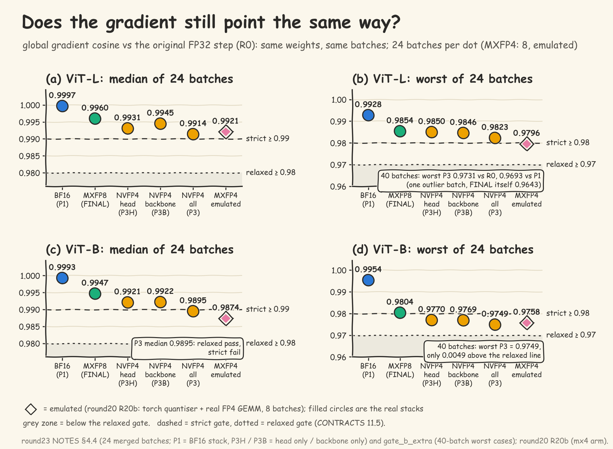

门定义（`train-opt/CONTRACTS.md` 11.5）：**严格门** = 全局梯度余弦中位数 ≥ 0.99 且最小 ≥ 0.98；**放宽门** = 中位数 ≥ 0.98、最小 ≥ 0.97、loss 相对差 ≤ 2e-2，外加 S 门（50 步 × 2 批 × 4 个场景，EMA 损失偏差 ≤ 5%）。

| 栈 | ViT-L（24 批） | ViT-B（24 批） | 门 |
|---|---|---|---|
| FINAL（MXFP8） | 0.9960 / 0.9854 | 0.9947 / 0.9804 | 严格门过 |
| P3（NVFP4） | 0.9914 / 0.9823 | 0.9895 / 0.9749 | 放宽门过，**严格门不过**（ViT-B） |
| P3，40 批最差 | 0.9731 对 R0、0.9693 对 P1（1 批离群，FINAL 自己 0.9643）→ 对 P1 低于 0.97 | 0.9749 对 R0、0.9735 对 P1（离放宽线只剩 0.0049 / 0.0035） | – |

P3 的 S 门 8 个场景全过（EMA 偏差最大 0.41% / 0.67%），graph 与 eager 等价，导出 / resume 通过。

### 5.7 最终栈

| 补丁（按顺序） | 作用 |
|---|---|
| round1 / 3 / 5 / 7 | 去同步、padded loss / matcher（可进 graph）、LN 融合 |
| round11 | BF16 autocast、flash / cuDNN attention、triton RoPE |
| round13 | QuACK GEMM 融合块（LN / GELU / 残差 / γ 的 epilogue） |
| round17 | MXFP8 block-scaled GEMM（FINAL 的 fc / proj / qkv dgrad、wgrad） |
| round14 | 融合 head：ConvT 当 GEMM + 3 个融合 CUDA kernel |
| round15 | 扁平 fp32 master / grad，2 个 kernel 完成 clip + AdamW，设备端 lr 日程 |
| round16 `StepGraphRunner` | 前向 + loss + 反向 + 优化器整步一次 `replay()` |
| **round21 + round22**（P3） | FP4 融合量化器 + head（21）、骨干（22）的 NVFP4 dgrad / wgrad |

### 5.8 怎么跑

```bash
export PYTHONPATH=$PWD/train-opt:$PWD/src
ulimit -n 65535            # DataLoader workers 多时需要；默认 1024 会报 "received 0 items of ancdata"

# FINAL（MXFP8），真实 loader，200 步
python train-opt/round19_final/run_final.py --model vitl16 --steps 200 --workers 16 --persistent

# P3（NVFP4）
python train-opt/round23_fp4_final/run_final.py --model vitl16 --stack P3 --steps 200

# ViT-B 的默认档 P3_H2
python train-opt/round25_fp4_harden/run_final.py --model vitb16 --stack P3_H2 --steps 200

# 复现整步速度 / 门
python train-opt/round23_fp4_final/run.py --model vitl16 --stack P3 --runner graph --action bench
```

- 默认路径（数据集、权重、`/root/autodl-tmp/train-opt-tmp` 缓存与锁）在 `train-opt/common/config.py`，换机器要改。
- 每张图的目标数不能超过 `--max-targets`（默认 2，本数据集最大 2）。
- 导出的模型与原版兼容：`lightly_train.load_model(export)` 直接可用，checkpoint 能在原版路径上 resume。

## 6 如实说明与未完成项

**推理**

- 可信度分两级：**R9 `r5_v1`、R11、R12 过了精度门**；**MXFP8 / NVFP4 / MXFP4 整模型只测了速度**，只有 mask-logit cos（ViT-B MXFP4 只有 0.988）。round10 的假量化仿真表明旧的 head-IoU ≥ 0.95 门对全骨干 FP4 是不过的。
- NVFP4 激活的每张量 scale 是第一次调用时静态标定的，换一段视频可能要重新标定。
- 表里的数字来自不同场次（MXFP8 一行是 round13 那一场）；同场次总表（round15）只有脚本，没有结果。ViT-B 的视频 FPS 被解码 / host 卡住，机器负载高时更差（负载 15–21 时 ViT-B 视频 FPS 明显低于空闲时）。
- 自写的 FP4 GEMM（R14 step 2）没做完，比 QuACK 慢（ViT-L 4.47 对 3.96 ms）；README 里的 FP4 数字是 QuACK 版（step 1）。
- 只在 RTX 5090（sm_120）、一段视频、2 类数据集上验证；竖图仍回退到 eager backbone。

**训练**

- **全阶段没有跑 epoch 训练，也没有 mIoU / head IoU 对照**，精度证据只有 few-batch 的门（B 门：8–40 批；S 门：50 步 × 2 批 × 4 场景）。
- P3 只过**放宽门**；两个模型都不满足严格门。满足严格门的最近一档是 FINAL。
- ViT-B 的推荐默认是 `P3_H2`（177.4 img/s，×1.10）：它的 S 门、graph_equiv、导出 / resume 都没有跑；P3 是速度档（×1.20），有一批掉到放宽线下（对 P1 的最小余弦 0.9655）。
- `round26_fp4_release` 只搭好了入口；`common/config.py` 里还没有最终默认值常量（dY headroom 32、ViT-B 用 P3_H2 都还没写进去）。
- ViT-L 的 40 批里有 1 批对 P1 的最小余弦是 0.9693，低于 0.97 线；那是一个 MXFP8 本身就不过的离群批（FINAL 自己 0.9643），对 R0 则是 0.9731。
- MXFP4 没有做整步实测；`round24` 的量化器优化只快 0.5–1.4%，低于发布线，没有合入。
- validation 与 checkpoint 仍占一个 epoch 的 29–33%（R18 没做）。

## 7 基线脚本

两个基线脚本在 `scripts/` 里，默认路径写在脚本顶部，用参数覆盖。

```bash
pip install -e .
pip install pycocotools opencv-python
```

**数据格式**（COCO 分割，polygon 会被脚本自动转成语义分割 mask）

```text
DATA_ROOT/
  train/  _annotations.coco.json  *.jpg
  valid/  _annotations.coco.json  *.jpg
```

**训练**

```bash
python scripts/train_dinov3_eomt_head.py \
  --data-root /path/to/DATA_ROOT \
  --backbone-weights /path/to/dinov3_vitb16_pretrain_lvd1689m-73cec8be.pth \
  --runs-root /path/to/runs \
  --model dinov3/vitb16-eomt --epochs 20 --batch-size auto
```

常用参数：`--batch-size auto`（自动探测最大可跑 batch）、`--skip-batch-probe`、`--backbone-freeze`、`--out DIR`（必须是空目录）、`--precision bf16-mixed`。输出 `best.pth`、`last.pth`、`run_config.json` 和 `exported_models/`。

**视频推理**

```bash
python scripts/infer_dinov3_eomt_head_video.py \
  --model /path/to/exported_models/exported_best.pt \
  --video-dir /path/to/videos --out-dir /path/to/infer_video --overwrite
```

